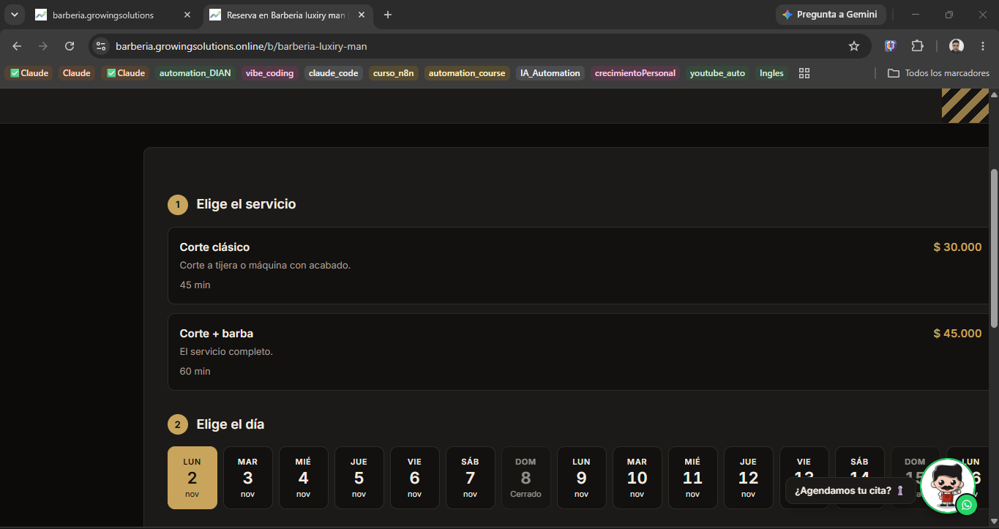
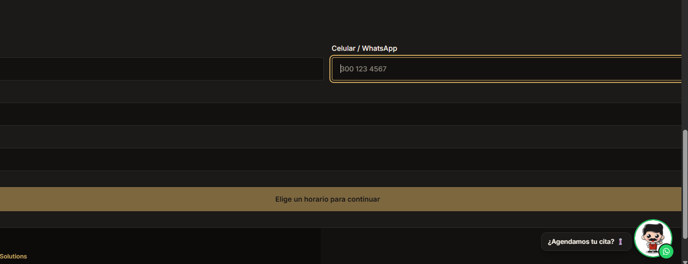
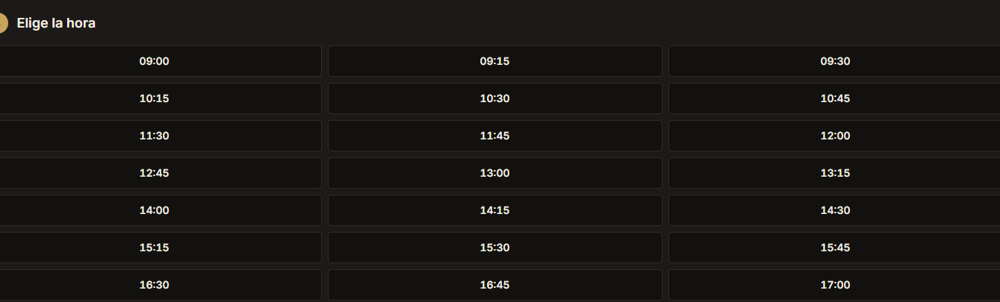
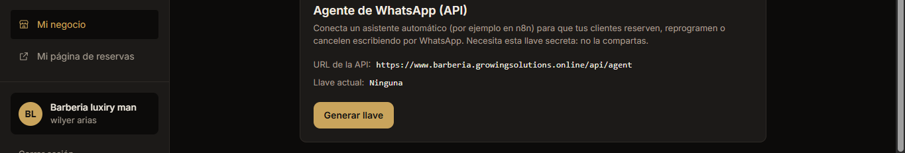
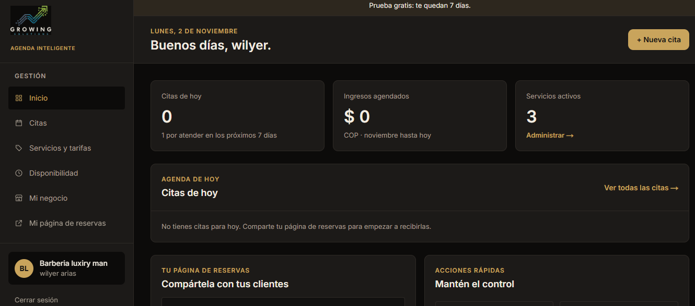
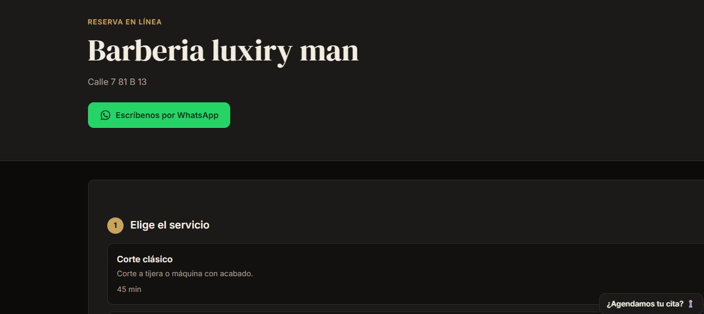

# Modificaciones solicitadas — Proyecto de reservas para barberías

## Propósito y alcance

Este documento reúne los cambios solicitados para implementar sobre un **proyecto que ya está construido**. Conserva el orden de los requerimientos originales, las imágenes de referencia y la nueva solicitud de registro y administración de clientes.

**Criterio de implementación:** aplicar los cambios sobre la solución existente. No reconstruir la aplicación ni modificar funcionalidades ajenas a estos requerimientos. Mantener los datos y procesos actuales, salvo los ajustes necesarios para incorporar las funciones descritas.

---

## 1. Mensaje promocional: tamaño y color

**Solicitud:** poner este mensaje más grande y de color brillante rojizo (fucsia).

---

## 2. Página de reservas: presentación de la tarjeta y calendario

Cuando el cliente abre la página mediante el link compartido, el menú se muestra como en las referencias siguientes.

**Cambios solicitados en la página de reservas:**

1. Mostrar la *card* centrada en toda la página y más pequeña, de modo que se pueda ver toda la información.
2. La opción del calendario debe mostrar el mes completo y utilizar iconos más pequeños.

---

## 3. Selección de horarios

En la opción **“Elegir la hora”**, mostrar los horarios del día de la siguiente manera. La solicitud indica: **“crea tu propio diseño”**.

### Distribución solicitada

| DIA - AM | TARDE - NOCHE - PM |
|---|---|
| 9:00 | 2:00 |
| 10:00 | 3:00 |
| 11:00 | 4:00 |
| 12:00 | 5:00 |
|  | 6:00 |
|  | 7:00 |
|  | 8:00 |
|  | 9:00 |

También se solicitan los horarios en intervalos de 30 minutos:

| DIA - AM | NOCHE - PM |
|---|---|
| 9:30 | 2:30 |
| 10:30 | 3:30 |
| 11:30 | 4:30 |
| 12:30 | 5:30 |
|  | 6:30 |
|  | 7:30 |
|  | 8:30 |
|  | 9:30 |

*Nota de fidelidad al original: se conserva la distribución y los horarios indicados en el documento fuente; no se agregan horas que no estén especificadas.*

---

## 4. Botón “Terminar” en la confirmación de reserva

Agregar un botón al lado de **“Hacer otra reserva”** con el label **“Terminar”**. Su función debe ser cerrar la página, porque el cliente ya terminó la reserva y no desea hacer otra adicional.

---

## 5. Menú “Mi negocio”: conexión del asistente de WhatsApp

En el menú **“Mi negocio”**, dejar el mensaje como:

**“Conecta tu asistente de whatsapp”**

El texto debe decir exactamente:

> Para conectar un agente a whatsapp el comercio debe tener cuenta empresarial de whatsapp y contactarse con Growing solutions. Nota: Este servicio se ofrece solo para membresías activas mensuales.

---

## 6. Menú “Mi negocio”: tablero contable

Incluir en el menú **“Mi negocio”** un tablero contable que muestre un dashboard con:

- Resumen de los servicios prestados.
- Valor de los ingresos.
- Opción para que el cliente seleccione las fechas sobre las cuales quiere consultar el reporte.
- Gráfica estadística para comparar las fechas que el cliente seleccione.

La solicitud no define métricas adicionales, fórmulas, tipos de gráfica ni reglas contables; esos detalles no se especifican en el documento fuente.

---

## 7. Gestión de empleados/barberos y flujo de reserva

Modificar el tablero de la página e incluir, después del botón **“Inicio”** en la barra izquierda, una opción para que el administrador o propietario de la barbería cree los empleados **“barberos”**.

Cada barbero debe tener un perfil diferente que permita:

- Agendar citas.
- Reprogramar citas.
- Cancelar citas.

Además, cuando los clientes reciban el link de acceso a la página, deben escoger primero al **“barbero”** y después continuar con la selección de:

1. Tipo de servicio.
2. Día.
3. Hora.
4. Los demás datos del proceso de reserva.

---

## 8. Registro y administración de clientes

Incorporar una opción para crear y registrar clientes, con el propósito de construir una base de datos propia de cada negocio que pueda utilizarse posteriormente para actividades administrativas y/o de marketing.

### 8.1. Opción de creación de clientes en el menú principal

Agregar en el menú principal del sistema un botón u opción identificada como **“Clientes”** o **“Crear clientes”**.

La opción debe permitir que los siguientes perfiles registren clientes:

- Administrador.
- Propietario del negocio.
- Empleados/barberos.

Al seleccionar esta opción, se debe desplegar un formulario para ingresar la información personal del cliente. Los registros deben quedar almacenados en una base de datos asociada al negocio, para su consulta y uso posterior en actividades administrativas y/o de marketing, de acuerdo con la autorización y la política de tratamiento de datos aplicable.

### 8.2. Opción de registro en la página compartida con los clientes

En la página pública de reservas, a la que acceden los clientes mediante el link compartido, también debe existir una opción para registrarse como cliente de la barbería.

El título que debe mostrarse es:

> Registrate como cliente de la barberia "zxy" para futuros descuentos y/o novedades

El texto **“zxy”** representa el nombre de la barbería y debe reemplazarse dinámicamente por el nombre del negocio correspondiente.

La opción debe mostrarse como un botón. Al seleccionarlo, debe desplegar el mismo formulario de registro disponible en el menú principal.

### 8.3. Campos del formulario

El formulario debe solicitar los siguientes datos:

1. Nombre completo.
2. Número de teléfono celular.
3. Correo electrónico.
4. Fecha de nacimiento.

### 8.4. Política de tratamiento de datos y carácter opcional

- El formulario debe incluir acceso visible a la **Política de Tratamiento de Datos Personales** del negocio.
- El registro debe ser completamente opcional.
- El cliente debe poder realizar una reserva sin registrarse ni diligenciar este formulario.
- La opción de registro no debe bloquear, retrasar ni condicionar el proceso normal de reserva.
- La autorización para el tratamiento de datos debe presentarse de forma clara y separada, según corresponda a la política del negocio.
- La información recopilada debe quedar disponible para los fines administrativos y/o de marketing autorizados por el titular de los datos.

**Importante:** el documento de requerimientos no proporciona el texto legal de la política ni define el mecanismo técnico de almacenamiento, conservación, consulta o eliminación de los datos. Esos elementos deben definirse con el negocio antes de implementar la funcionalidad; no se debe inventar ni presentar un texto legal como si ya hubiera sido aprobado.

---

## Resumen de cambios solicitados

| N.º | Área | Cambio principal |
|---:|---|---|
| 1 | Mensaje promocional | Aumentar tamaño y aplicar color fucsia brillante. |
| 2 | Página de reservas | Centrar y reducir la card; mostrar el mes completo y reducir iconos. |
| 3 | Selección de horarios | Rediseñar la presentación de horarios AM/PM con intervalos de 30 minutos. |
| 4 | Confirmación de reserva | Añadir el botón “Terminar” junto a “Hacer otra reserva” para cerrar la página. |
| 5 | Mi negocio — WhatsApp | Actualizar el encabezado y el texto informativo de conexión. |
| 6 | Mi negocio — tablero contable | Incorporar resumen de servicios, ingresos, filtros de fechas y gráfica comparativa. |
| 7 | Administración — barberos | Crear perfiles de barberos y hacer que el cliente seleccione primero al barbero en la reserva. |
| 8 | Clientes | Permitir crear clientes desde el menú principal y registrarse voluntariamente desde la página compartida, con formulario y política de tratamiento de datos. |

## Consideraciones para implementar sobre el proyecto existente

- Mantener las funcionalidades actuales que no estén expresamente incluidas en estos requerimientos.
- Integrar los cambios en las pantallas, componentes y navegación existentes.
- Conservar la secuencia del flujo de reserva, incorporando la selección del barbero antes del servicio.
- El registro de clientes debe estar disponible tanto para los perfiles internos autorizados (administrador, propietario y barberos) como para los clientes desde la página compartida.
- Los dos puntos de entrada deben utilizar el mismo formulario y alimentar la base de datos del negocio.
- El registro público debe ser opcional y nunca convertirse en requisito para reservar.
- No asumir reglas de negocio, permisos adicionales, fórmulas contables ni configuraciones no descritas: deben validarse antes de implementarlas.
